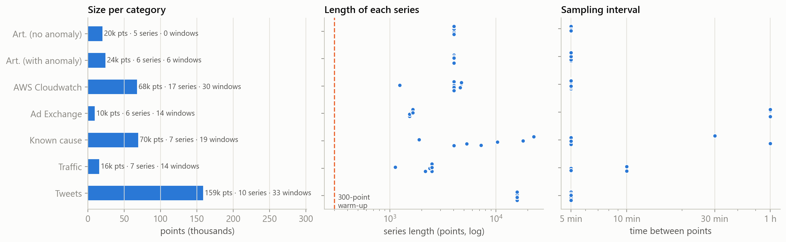
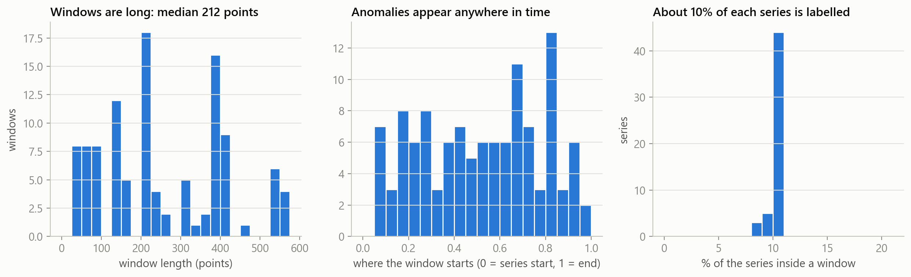
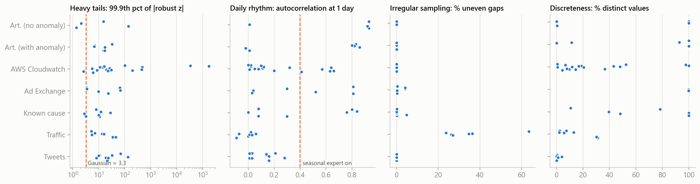
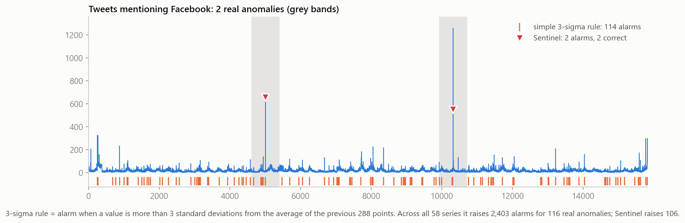
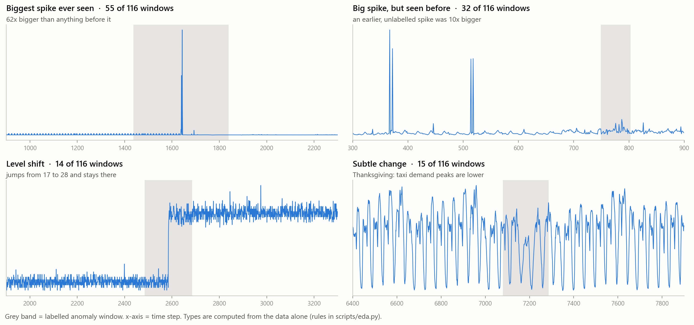

# 01 · Data and EDA (exploratory data analysis)

EDA means looking carefully at the data before building or tuning anything.
None of the work on this page used any of our 15 runs: it only reads the data
and the labels. Script: `python scripts/eda.py`. Tables are in `results/eda/`.

## 1. What data we have

The data is the Numenta Anomaly Benchmark (NAB): 58 time series, 365,558 points,
116 labelled anomaly windows. We downloaded the series from Kaggle; the labels come
from Numenta's official repository (Kaggle has no labels).

| Category | Series | Points | Typical length | Time between points | Labelled windows |
|---|---|---|---|---|---|
| Artificial, no anomaly | 5 | 20,160 | 4,032 | 5 min | 0 |
| Artificial, with anomaly | 6 | 24,192 | 4,032 | 5 min | 6 |
| AWS Cloudwatch (servers) | 17 | 67,740 | 4,032 | 5 min | 30 |
| Ad Exchange (online ads) | 6 | 9,610 | 1,624 | **1 hour** | 14 |
| Known cause (real failures) | 7 | 69,561 | 7,267 | 5 min to 1 hour | 19 |
| Traffic (road sensors) | 7 | 15,664 | 2,495 | 5 to 10 min | 14 |
| Tweets (Twitter volume) | 10 | 158,631 | 15,856 | 5 min | 33 |

**What this means for us:** Ad Exchange series are short and hourly. Our detector
spends its first 300 points only learning, and for an hourly series that is 12.5 days,
almost a fifth of the whole series.

## 2. How we prepare the data (preprocessing)

We keep preparation minimal on purpose, because a streaming detector only ever
sees one new point at a time:

1. Read each CSV (`timestamp, value`) and parse the timestamps.
2. Keep the points **in file order**: that is the order a live stream would deliver them.
3. **No** filling of gaps, **no** resampling to a fixed grid, **no** scaling. Each
   expert learns the scale of its own series while it streams.
4. Work out the sampling interval (median time between points). It is only used to
   know how many points make one day, for the daily-pattern expert.

Data-quality checks we ran:

| Check | Result | What we did |
|---|---|---|
| Missing values | 0 | nothing needed (the detector would hold its state on a missing value) |
| Duplicate timestamps | 37 repeats in 7 series | kept them; each point is still one step of the stream |
| Time going backwards | 1 case (machine_temperature, 55 minutes) | kept file order |
| Uneven gaps between points | **22–34% of all steps in every Traffic series** | treated as one stream; gaps are not related to the anomalies |

## 3. What the labels look like

- Windows are **long**: the median window is 212 points. Any alarm inside a window counts.
- About **10% of every series** is inside a window (that is how NAB built the labels).
- Anomalies appear **anywhere in time**, not just at the end.
- **3 windows start inside the 300-point warm-up**, and **10 start in the first
  450 points**. v5 caught only 2 of those 10.

## 4. What the signals look like

- **Heavy tails (left panel of the traits chart).** If the data were simple bell-curve noise, the most extreme
  0.1% of points would sit about 3.3 noise units from the middle. In **47 of 58 series** they
  sit more than 6 units away, often 100s. So a simple "3-sigma" rule floods us with
  alarms: across all 58 series it raises **2,403 alarms for 116 real anomalies** (Sentinel raises 106). This is why Sentinel uses **extreme-value statistics** to judge how rare a value is.
- **Daily rhythm.** 18 series repeat strongly every day (mostly artificial, some AWS,
  Ad Exchange and Known cause). The daily-pattern expert only switches on for those.
- **Uneven sampling.** Only Traffic has it, and there it is everywhere.
- **Discreteness.** Tweets are counts and CPU readings are rounded, so many values repeat.
  This is why the detector puts a small floor under every noise estimate.

## 5. What kinds of anomalies are inside the windows

We sorted all 116 labelled windows into simple types (rules in `scripts/eda.py`):

| Type | Plain meaning | Count |
|---|---|---|
| New extreme | a spike or dip **bigger than anything seen before** in that series | **55** |
| Repeated extreme | a big spike or dip, but **an equally big one already happened earlier without a label** | 32 |
| Level shift | the series jumps to a new level and stays there | 14 |
| Subtle | a change in pattern or context, no single big value | 14 |
| Volatility | the noise level doubles or halves | 1 |

(Per-category breakdown: `results/figures/extra/eda_anomaly_types_by_category.png`.)

**The key EDA finding.** Almost half of all anomalies are *new extremes*. A detector
built on extreme-value statistics should catch nearly all of them, but v5 caught only
**31 of 55 (56%)**. That gap is fixable. "Repeated extremes" (v5: 34%) are much harder:
something equally big happened before and nobody labelled it, so even a human would
struggle to call the second one an anomaly.

## 6. Looking inside the starting model (error analysis of run 1)

Run 1 reproduced v5 and saved every expert's internal "surprise" for every point.
Reading those saved outputs is free. Script: `python scripts/analyze_run.py 1`.

- Of the 57 missed windows (1 more sits entirely inside the warm-up, so no expert saw it), **36 came closest to firing on the `level` expert** (the spike/dip detector).
- The level expert's fitted tail shape had median **γ = 0.27**, and **above 0.3 in 25 of 58
  series**. A shape that heavy means "huge values are normal", so the expert could
  barely ever fire. Even on our synthetic test series (a smooth daily wave plus bell-curve
  noise and one injected anomaly), whose real tail is light (γ ≤ 0), the old fit came out at
  γ = 0.24–0.41.
- Example: a spike on `exchange-4_cpm` was **111 noise units** above normal, but the detector
  would only have fired at **690** units.
- None of the missed windows was blocked by the cooldown; most never scored near the threshold.

## 7. What the EDA told us to try, and not to try

| Idea | What the data said | Decision |
|---|---|---|
| Make the tail fit less heavy when evidence is thin | 36/57 misses closest on `level`; γ often 0.3–0.4 | **try it** (runs 2, 3, 6, 7) |
| Stop alarms that keep firing every 300 points | 5 false alarms (and 0 hits) fire on the very first point after the cooldown ends | **try it** (run 4) |
| Shorter warm-up | 10 windows start in the first 450 points, only 2 caught | **try it** (run 5) |
| Combine experts when several agree | agreement is 4× more common in missed windows, but never extreme enough to reach the alarm level | skip, would gain ~0 windows |
| Shorter cooldown | the 4 misses after a cooldown would not have fired anyway (best score 1.7–4.0 < 5) | skip |
| Change the alarm risk level | hits and false alarms sit at the same scores near the threshold; phase-1 history showed a flat curve | skip |
| Special filter for `shift` alarms | its 15 hits and 13 false alarms look identical | skip |
| Treat traffic gaps specially | gaps are everywhere, not near anomalies | skip |
