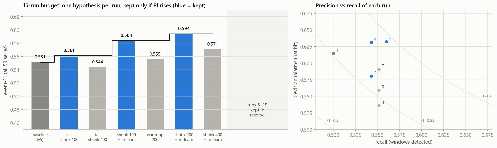

# 02 · The 15-run budget

## The rule

We may run **at most 15 experiments**.

- **One run** = run one detector setting on all 58 series and score it against the labels
  once (one fit-and-validation cycle).
- **Not a run:** loading and checking data, EDA, drawing plots, reading the saved outputs of a
  finished run, and smoke tests on made-up (synthetic) data that never touch the NAB labels.

## How we kept ourselves honest

1. **Write the reason first.** Every run is started with its hypothesis
   (`--why "..."`). The text is saved in `runs/run_log.csv` *before* the result exists.
2. **The script counts for us.** `scripts/experiment.py` numbers the runs and refuses run 16.
3. **Save everything.** Each run writes `runs/run_NN/`: settings, scores, every window, every
   alarm, every point with each expert's surprise. So no run ever has to be repeated, and all
   the error analysis afterwards is free.
4. **One clear keep/drop rule**, decided in advance: keep a change only if event-F1 goes up
   *and* more categories improve than get worse.
5. **A held-out check.** After each run we also compute the leave-one-category-out score:
   pick the best run using 6 categories, score it on the 7th, repeat for all 7.
6. **Test code without spending runs.** New code was first tested on synthetic series with
   injected anomalies (`experiment.py --dry`), which the budget does not count.

## Every run

| Run | What we changed | Why (written before the run) | Event-F1 | Windows | False alarms | Decision |
|---|---|---|---|---|---|---|
| 1 | nothing (v5) | reproduce the starting point and save its internals | 0.551 | 58 | 37 | reference |
| 2 | tail shrinkage, strength 100 | the tail fit is too heavy, so obvious spikes are missed | 0.561 | 63 | 47 | **keep** |
| 3 | tail shrinkage, strength 400 | does even stronger shrinkage help? | 0.544 | 64 | 58 | drop: too many false alarms in Tweets |
| 4 | + re-learning after a regime change | alarms that re-fire right after the cooldown are the same incident | 0.584 | 63 | 38 | **keep**: removed 9 false alarms, lost 0 windows |
| 5 | warm-up 300 → 200 | 10 windows start early; short hourly series lose a lot to warm-up | 0.556 | 64 | 52 | drop: 200 points is too little to learn from |
| 6 | shrinkage strength 200 (with re-learning) | check how sensitive the strength is now that re-learning is on | **0.594** | **65** | 39 | **keep** (final) |
| 7 | shrinkage strength 400 (with re-learning) | bracket the best strength from above | 0.571 | 64 | 45 | drop: 200 is the peak |

**Shrinkage strength, with and without re-learning:**

| Strength (n0) | 0 | 100 | 200 | 400 |
|---|---|---|---|---|
| without re-learning | 0.551 | 0.561 | not run | 0.544 |
| with re-learning | not run | 0.584 | **0.594** | 0.571 |

The best value sits in the middle and is bracketed on both sides, so it is not a lucky
edge value.

## Runs we saved by thinking first

These ideas were checked using the saved outputs of earlier runs (free), and dropped
before spending a run on them. Details are in [01 · Data and EDA](01_data_and_eda.md#7-what-the-eda-told-us-to-try-and-not-to-try).

- combining experts when they agree
- shorter cooldown
- changing the alarm risk level
- a special filter for `shift` alarms
- calibrating the evidence accumulator per series
- longer novelty memory
- special handling of Traffic time gaps

## Why we stopped at 7 runs

A simple piece of arithmetic guided us. At our current numbers, **finding one more
anomaly window is worth about 2.4 extra false alarms** in event-F1. Any change that costs
more false alarms than that per extra window makes the score worse.

- Run 2 bought 5 windows for 10 false alarms (2 each): worth it.
- Runs 3, 5 and 7 bought about 1 window for 6 to 14 false alarms: not worth it.
- Run 4 removed 9 false alarms for free: always worth it.

Every idea left on our list was, by the saved data, below that break-even line, and
fine-tuning the shrinkage strength further (150, 250…) would be chasing noise: one window
changes F1 by about 0.005. So we stopped, with **8 runs left in reserve**, for example for
when the organisers' official starter pack arrives.

## Honest caveats

- **Held-out score.** The leave-one-category-out score is 0.594: run 6 is the best choice
  for every held-out category. But we designed the hypotheses after looking at all labelled
  data, so the score on the organisers' hidden data will probably be somewhat lower. In
  phase 1 that gap was about 0.02.
- **Phase 1 had no budget.** Before the 15-run rule we logged 124 development runs
  (`experiments.csv`), which took v1 (0.343) to v5 (0.551). The 15-run budget applies to this
  improvement phase, which starts from v5.
