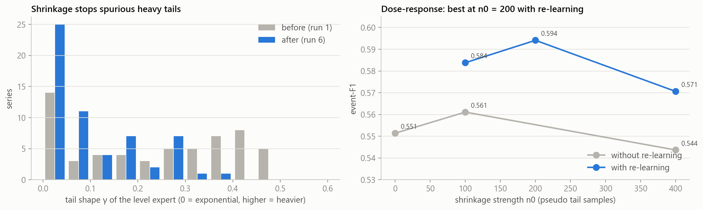
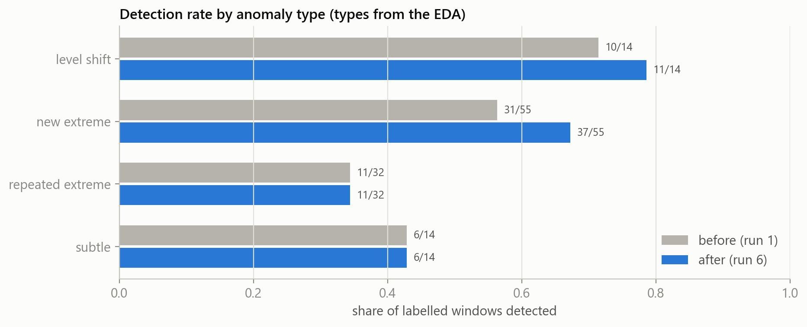
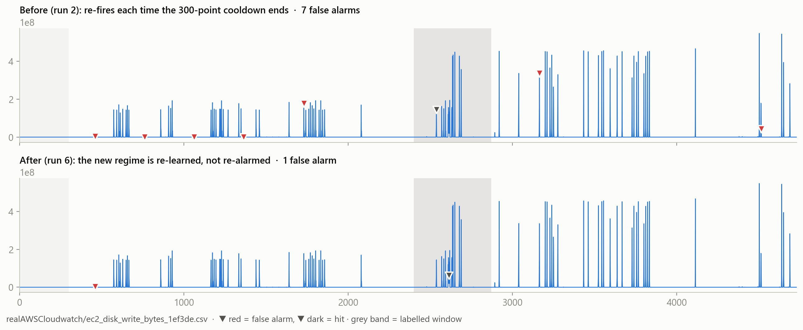

# 03 · The two improvements, explained simply

## Background: how Sentinel decides "this is an anomaly"

For every new point, five *experts* each give a surprise score: spikes (`level`), broken
daily pattern (`seasonal`), a lasting jump (`shift`), noise bursts (`volatility`) and
never-seen-before shapes (`novelty`).

A score on its own means nothing: "7" might be huge on one series and normal on another.
So each expert keeps a **tail curve** that answers one question: *how often have scores this
big happened on this series?* That turns any score into a probability. Sentinel raises an
alarm when something should happen less than **once in 100,000 points**. The same rule works
on every series, with no hand-picked cutoffs.

The tail curve is fitted to the biggest scores seen so far (extreme-value statistics). Its
most important setting is its **shape γ (gamma)**:

- γ = 0 means a "normal-weight" tail: big values get rare quickly.
- γ = 0.4 means a heavy tail: huge values are fairly common.

## Improvement 1: tail-shape shrinkage

**The problem.** After the 300-point warm-up, each expert has seen only about **12** big
scores. Guessing the shape from 12 values is very shaky, and one odd value in the warm-up can
make the guess come out heavy. Once the curve believes "huge values are normal", the expert
can barely fire again, and every alarm it does raise is fed back into the curve, making it
heavier still.

**Example** (`exchange-4_cpm`, an ad-price series):

| | Value | Normal level | Noise units above normal | Shape γ | Units needed to alarm | Result |
|---|---|---|---|---|---|---|
| Before | 14.13 | 0.59 | 111 | 0.44 | **690** | missed |
| After | 14.13 | 0.59 | 111 | 0.10 | **79** | **alarm** |

**The fix.** Do not believe a heavy curve until there is enough evidence for it.

```
gamma_used = gamma_fitted × peaks_seen / (peaks_seen + 200)
```

With 12 big values seen, only about 6% of the heavy-tail guess is used. After 2,000 big
values it is about 90%. So long, really heavy-tailed series (like Tweets) still end up with
their heavy curve; short series (like Ad Exchange) are not blinded by a bad early guess.
Only heavy-looking estimates are touched; light ones stay exactly as before.



**Effect.** New extremes caught went from 31 to 37 of 55, and level shifts from 10 to 11 of 14.



## Improvement 2: re-learning after a regime change

**The problem.** After an alarm, Sentinel waits 300 points (the *cooldown*) before it may
alarm again, so one incident gives one alarm. But some series change for good: for example
a server disk that was idle for days and then starts working in bursts. The old detector
learned "normal" from the idle days, so it fired again **the moment every cooldown ended**:
points 461, 762, 1063, 1364… exactly 301 apart.

**The fix.** If the alarm condition is *still on* on the very first point after the cooldown,
it is the same incident still going on, which means **the normal has changed**. So instead of
raising another alarm, Sentinel rebuilds each expert from the last 300 points (the new normal).
The `novelty` and `seasonal` experts keep their long memory.



**Effect.** In run 2, 5 alarms fired on the first point after a cooldown, and **all 5 were false**.
With re-learning (run 4): false alarms went from 47 to 38, **no window was lost**, and AWS
Cloudwatch went from 0.475 to 0.549.

## Why these two fit the challenge

- The problem statement asks for "adaptive threshold logic". Both changes make the threshold
  *adapt correctly*: shrinkage when the detector knows little, re-learning when the world
  changes.
- Neither one adds a hand-picked cutoff per series. Each adds one global setting with a
  clear meaning ("how many peaks before we trust a heavy tail", and on/off).
- Both are still fully streaming: each point is processed once, with only the past.
- Speed is unchanged: about **61 µs per point** (16,000 points per second on one core).
  Re-learning happened only **3 times in all 365,558 points**. Each one takes about 0.2 s,
  because the novelty expert re-scans up to 6,000 points of history; that is a rare pause, not a
  change in normal speed.
